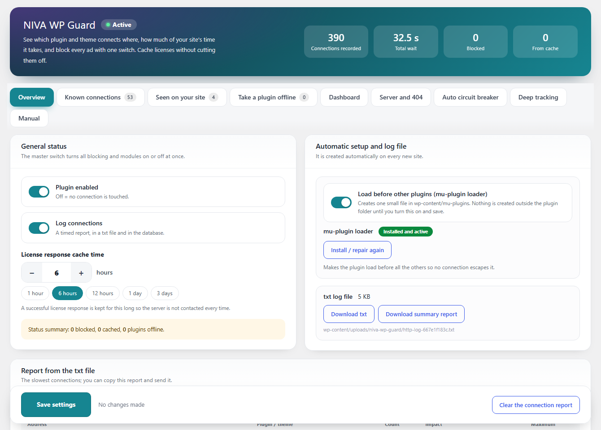
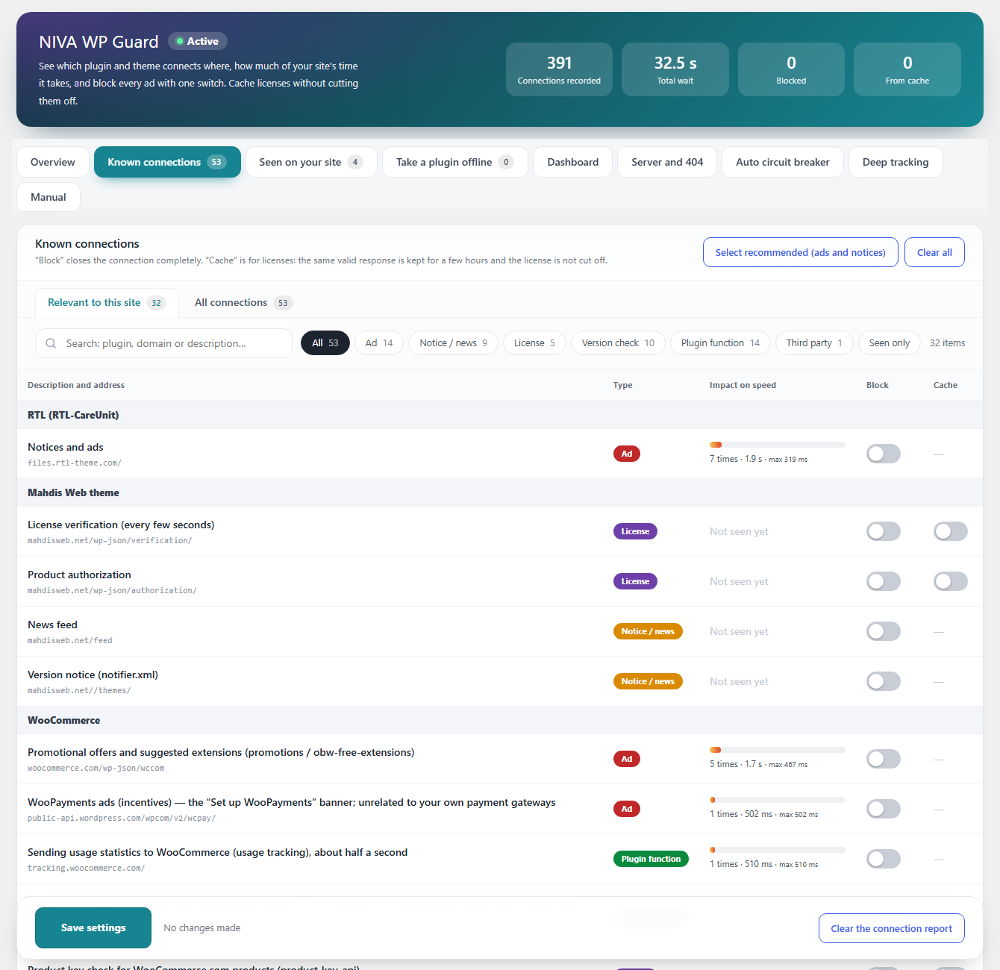
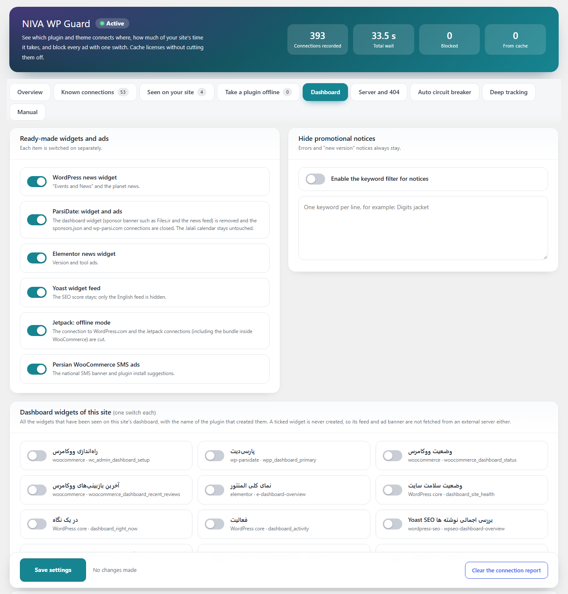
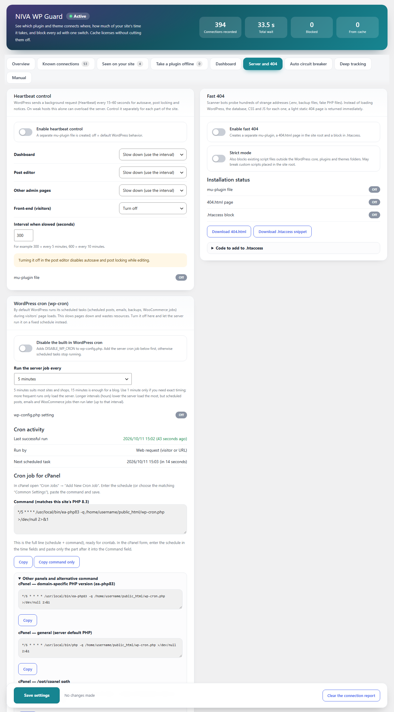
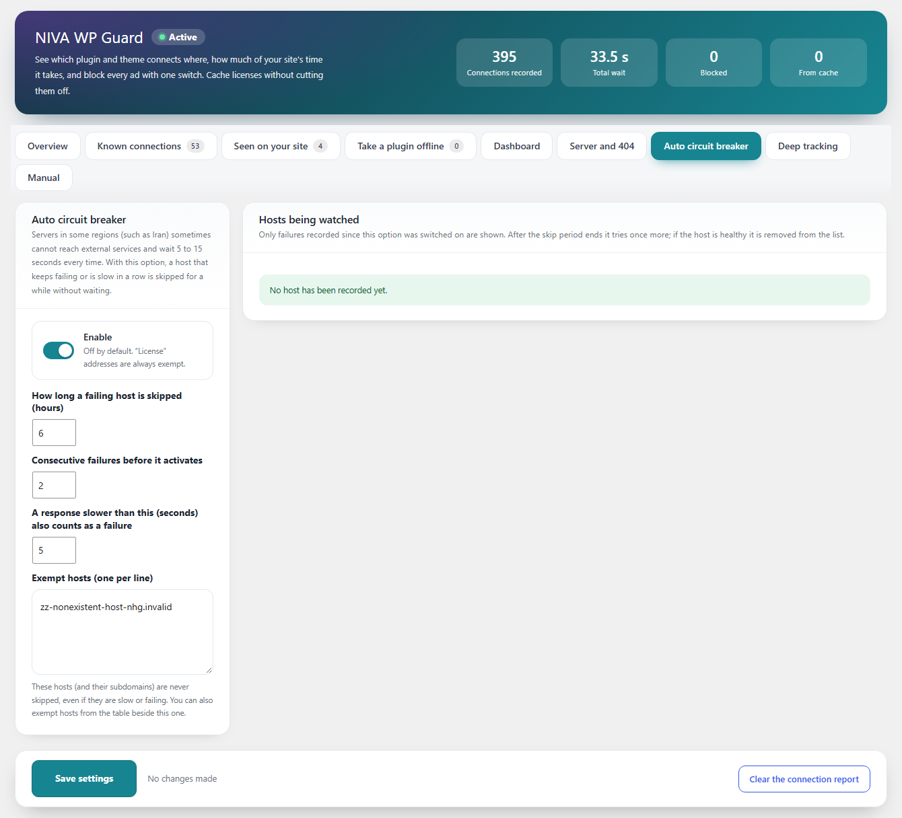
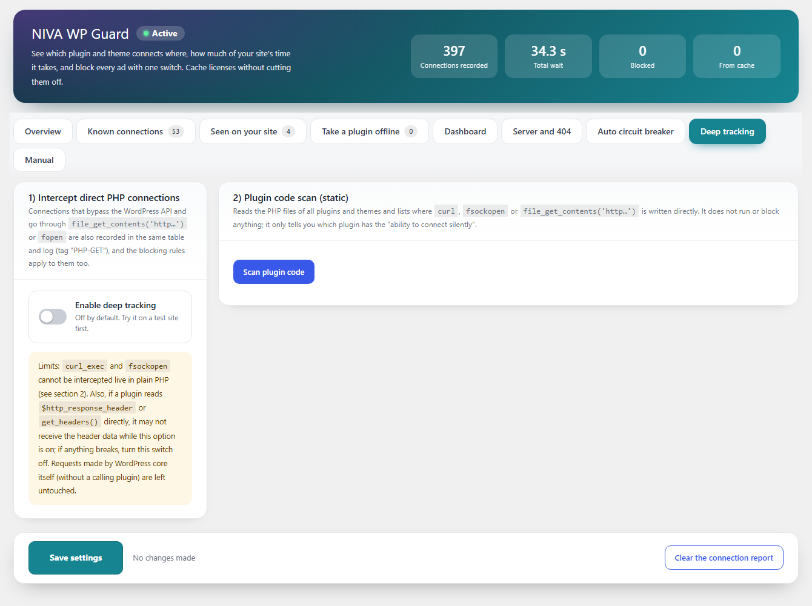

# NIVA WP Guard

**See and control every outgoing connection of your WordPress plugins and themes.**
Log each connection with its timing, block ads and promotional notices, cache license checks instead of cutting them off, skip unreachable hosts automatically, turn WP-Cron into a real server cron, and answer scanner probes with a fast static 404.

[فارسی](#فارسی) · [Install](#installation-guide) · [Features](#features-in-detail) · [Screenshots](#screenshots) · [FAQ](#faq)

Requires WordPress 6.0+ · PHP 7.4+ · License GPLv2 or later · Admin UI in 9 languages (LTR and RTL)

---

## Why this plugin exists

Many plugins and themes call home on every page load or in the dashboard: advertising feeds, news widgets, license checks, update checks, usage tracking. On a slow or filtered network (some hosting regions cannot reach many foreign servers at all) each of those calls can wait 5 to 15 seconds and slow down the whole site.

NIVA WP Guard shows **which plugin connects to which address and how much time it costs**, then lets you decide for each connection: leave it, block it, or (for licenses) cache the answer.

## Screenshots

| Overview | Known connections |
|---|---|
|  |  |

| Dashboard clean-up | Server tools and WP-Cron |
|---|---|
|  |  |

| Auto circuit breaker | Deep tracking |
|---|---|
|  |  |

---

## Installation guide

### Requirements
- WordPress 6.0 or newer, PHP 7.4 or newer.
- An administrator account (the settings page needs the `manage_options` capability).
- Nothing else. The plugin has no dependencies and makes **no external connections of its own**.

### Option 1: upload the zip from the dashboard (recommended)
1. Open the [latest release](https://github.com/Ali-MR-23/niva-wp-guard/releases/latest) and download **`niva-wp-guard-2.5.1.zip`** (the file under *Assets*, not "Source code").
2. In WordPress go to **Plugins → Add New → Upload Plugin**, choose the zip and click **Install Now**.
3. Click **Activate Plugin**.
4. Open **Settings → NIVA WP Guard**.

### Option 2: cPanel / FTP
1. Unzip `niva-wp-guard-2.5.1.zip` on your computer. You get one folder named `niva-wp-guard`.
2. Upload that folder to `wp-content/plugins/` (File Manager or FTP).
3. Activate the plugin in **Plugins**.

### Option 3: Git or WP-CLI
```bash
cd wp-content/plugins
git clone https://github.com/Ali-MR-23/niva-wp-guard.git
wp plugin activate niva-wp-guard
```

### First-time setup (about 3 minutes)
1. **Overview**: leave *Plugin enabled* and *Log connections* on. Browse your site and the dashboard for a few minutes so the plugin can record connections.
2. **Overview → Load before other plugins**: turn it on and save. This installs one small file in `wp-content/mu-plugins` so no plugin can connect before the logger starts. (Nothing is written outside the plugin folder until you do this.)
3. **Known connections → Relevant to this site**: click **Select recommended (ads and notices)** to block advertising and promotional feeds in one click, review the list, then **Save settings**.
4. **License checks**: do not block them. Turn on **Cache** instead (see below).
5. Come back after a day, open **Overview** and read the report of the slowest connections. Slow ones that are not in the list appear in **Seen on your site**.

### Upgrading
Upload the new zip the same way (**Add New → Upload Plugin**) and WordPress offers to replace the current version. Settings are kept.

### Coming from "NIVA HTTP Guard"
Deactivate the old plugin first, then activate NIVA WP Guard. Your settings, log, report data and menu choices are migrated automatically.

### Uninstalling
Deactivate the plugin to remove every file it created outside its own folder (mu-plugin files, `404.html`, the `.htaccess` block and the `DISABLE_WP_CRON` line). Deleting the plugin also removes its options and log folder.

### Troubleshooting installation
- **"Plugin file does not exist" / "package could not be installed"**: you uploaded the wrong zip. Use the zip from the release *Assets*, or make sure the zip contains one top-level `niva-wp-guard` folder.
- **Cannot write files**: if WordPress cannot write to `mu-plugins`, `.htaccess` or `wp-config.php`, the settings page shows download buttons and copy-paste instructions instead.
- **Site shows an error after enabling a server tool**: the plugin restores `.htaccess` (with backup) and `wp-config.php` automatically when the site answers with a 5xx error. You can also remove the files listed above by hand.

---

## Features in detail

The settings page is **Settings → NIVA WP Guard** and is organised in tabs.

### 1. Overview
- **Plugin enabled**: master switch. Off means no connection is touched.
- **Log connections**: every connection is recorded in the database and in a text file (`wp-content/uploads/niva-wp-guard/`), with caller, address, context (site, admin, cron, AJAX, REST) and duration.
- **License response cache time**: 1 hour, 6 hours, 12 hours, 1 day, 3 days or any number of hours.
- **Load before other plugins (mu-plugin loader)**: one small file in `mu-plugins` so the guard starts before every other plugin. Shows its status and a repair link.
- **Report**: counters at the top (connections recorded, total wait, blocked, served from cache), a downloadable text log, a downloadable summary report, and a copy-ready list of the slowest connections.

### 2. Known connections
A built-in registry of **53 known connections** with an explanation of what each one does, its type, its measured effect on your site and one switch each.

- **Relevant to this site / All connections**: the first tab lists only the rules whose plugin or theme is active on your site; the second shows the full list.
- **Search and type filters**: *Ad*, *Notice / news*, *License*, *Version check*, *Plugin function*, *Third party*, *Seen only*.
- **Impact on speed**: for every item that was observed, the number of calls, total time and the slowest call.
- **Block**: closes the connection completely. The request fails instantly instead of waiting.
- **Cache** (license and version-check items): a successful response is kept for the chosen number of hours, so the vendor's server is not asked on every request and the license is **not cut off**.
- **Select recommended / Clear all**: one click to block all ads and promotional feeds, or to reset.
- Blocking a *License* or *Plugin function* item shows a warning first, because it can lock a theme or stop SMS and orders.

Covered sources include WooCommerce (promotions, WooPayments ads, tracking, PayPal IPN, product-key checks), Jetpack and WordPress.com, WordPress core and plugin version checks, LiteSpeed Cache and QUIC.cloud, Solid Security, Rank Math, Elementor, Yoast SEO (including translations feeds, Wincher and the unofficial vip-themes server), WPForms, WP Mail SMTP, Code Snippets, and many Persian plugins and themes (Persian WooCommerce and SMS plugins, Digits, RTL plugins, WP-ParsiDate, Mahdis Web theme, Digify, Ace Plugins, Emalls, Torob, payamak-panel and Niva licenses).

### 3. Seen on your site
Connections that happened on your site but are **not** in the built-in list, grouped by plugin or theme, with counts and timing, so you can block or cache them too.

### 4. Take a plugin offline
Choose one or more plugins and **everything they send out is closed except wordpress.org**. Useful for a plugin that keeps contacting its own server for no reason you need. The plugin keeps working locally.

### 5. Dashboard
Clean the admin without deactivating anything.
- **Dashboard widgets**: the list of widgets detected on your dashboard with the plugin that adds each one; tick to remove. The widget code does not run and its feed is not fetched.
- **Admin menu items**: tick the items to hide (Dashboard, Settings and Plugins are protected so you cannot lock yourself out). Items are only hidden, not removed: the plugin stays active and its page still opens with a direct link. This includes menus that other plugins add very late.
- **Ready-made switches**: WordPress news widget, WP-ParsiDate widget and ads, Elementor news widget, Yoast widget feed, Jetpack offline mode, Persian WooCommerce SMS ads.
- **Promotional notices by keyword**: write words (one per line) and any admin notice containing them is hidden. Error notices and "new version" notices always stay visible.

### 6. Server and 404
Each tool is optional, off by default and writes files only after you enable it and save.

**Heartbeat control**
- Separate mode for **Dashboard**, **Post editor**, **Other admin pages** and **Front-end**: *WordPress default*, *Slow down (use the interval)* or *Turn off*.
- Interval from 1 to 3600 seconds (300 = every 5 minutes).
- Implemented as its own mu-plugin file, so it keeps working if you deactivate other things.

**Fast 404**
- Scanner bots probe addresses like `.env`, `backup.sql`, `wp-config.php.bak` or fake `.php` files. Instead of loading WordPress and the database for each one, the server answers with a light static `404.html`.
- Creates a separate mu-plugin, a designed bilingual `404.html` (RTL for Persian, LTR for others, no external fonts) and a marked block in `.htaccess`.
- **Safe by design**: your real files and redirect plugins are not affected; `?p=ID` short links keep working; old slugs and SEO redirects still redirect.
- **Strict mode** (optional) also blocks existing script files outside WordPress core, plugins and themes.
- Backs up `.htaccess` first and **rolls back automatically** if the site returns a server error. Provides an Nginx snippet and downloads for manual installation.

**WordPress cron (wp-cron)**
- Turns off the built-in cron (it runs inside visitors' page loads) by adding one marked `DISABLE_WP_CRON` line to `wp-config.php`. If the site breaks, the file is restored automatically. The line is removed when you switch the option off or deactivate the plugin.
- Choose how often the server should run it: 1, 5, 10, 15, 30 minutes or 1 to 6 hours.
- Shows a **ready cron job** matched to your PHP version and your real path, for cPanel (EasyApache `ea-phpXX`, default PHP), CloudLinux alt-php, DirectAdmin, Plesk, any host, WP-CLI, wget and curl. It gives the full crontab line and a **Copy command only** button for the cPanel form.
- **Cron activity**: last successful run, last failed run (with the error), how it was started (server command or web request) and the next scheduled task. A warning appears if scheduled tasks are overdue.

### 7. Auto circuit breaker
For servers that cannot reach some foreign hosts and wait many seconds every time. A host that fails (or answers slower than a limit) several times in a row is skipped for a while without waiting.
- Configurable skip time (hours), failures in a row, and the "too slow" limit in seconds.
- License addresses are always exempt; you can add exempt hosts.
- A table lists watched hosts, their status, when the skip ends, how many times it activated and the last error, with **Release all**.

### 8. Deep tracking
Some plugins bypass the WordPress HTTP API. This optional tab finds them.
- **Intercept direct PHP connections**: `file_get_contents( 'http…' )` and `fopen` are recorded in the same log and the same blocking rules apply.
- **Scan plugin code**: a static scan lists, per plugin and file, which files use `curl`, sockets or `fopen` and to which host or IP, with library files classified separately. Click a plugin to expand the file list.

### 9. Manual
Built-in help describing every tab and the type of each connection.

### Languages and direction
English, Persian, Arabic, Turkish, Russian, German, French, Spanish and Chinese (Simplified). The interface follows the site language and switches automatically between LTR and RTL.

---

## Files outside the plugin folder (only when you enable them)

| File | Created by | Removed when |
|---|---|---|
| `wp-content/mu-plugins/niva-wp-guard-loader.php` | Load before other plugins | option off, deactivate |
| `wp-content/mu-plugins/niva-wp-guard-heartbeat.php` | Heartbeat control | option off, deactivate |
| `wp-content/mu-plugins/niva-wp-guard-fast-404.php` | Fast 404 | option off, deactivate |
| `404.html` and a block in `.htaccess` | Fast 404 | option off, deactivate |
| one line in `wp-config.php` | Disable WP-Cron | option off, deactivate |
| `wp-content/uploads/niva-wp-guard/` | Logging | uninstall |

## FAQ

**Does it send my data anywhere?** No. It makes no external connections. The log stays on your site.

**Can blocking something break my site?** Blocking *License* or *Plugin function* connections can. Use *Cache* for licenses and read the warning before blocking a function. Ads, news and tracking are safe to block.

**Does it work on Nginx?** The logger, circuit breaker, cron control and Heartbeat work everywhere. Fast 404 cannot edit `.htaccess` on Nginx, so it shows the equivalent Nginx snippet.

**Do I need the mu-plugin loader?** It is recommended: without it a plugin that loads earlier than this one could connect before the logger starts.

**What happens if I disable WP-Cron but forget to add the server cron?** Scheduled posts, emails, backups and WooCommerce jobs stop running. The cron card warns you when tasks are overdue. Add the server job first.

## Contributing

Issues and pull requests are welcome. All PHP, CSS and JavaScript files are unminified. New text must be written in English with the `niva-wp-guard` text domain and wrapped in the translation functions.

## Author

Ali Mohajer · [GitHub](https://github.com/Ali-MR-23) · [WordPress.org profile](https://profiles.wordpress.org/alimohajer/)

Licensed under the GPL, version 2 or later.

---

## فارسی

**NIVA WP Guard** همه‌ی اتصال‌های بیرونی افزونه‌ها و قالب‌های وردپرس را نشان می‌دهد و کنترل می‌کند: ثبت هر اتصال با زمان آن، بستن تبلیغ و اعلان، کش کردن بررسی لایسنس به‌جای قطع کردنش، رد شدن خودکار از سرورهای در دسترس‌نبودنی، تبدیل WP-Cron به کرون واقعی سرور و پاسخ سریع ۴۰۴ به اسکنرها.

### چرا ساخته شد
خیلی از افزونه‌ها و قالب‌ها در هر بارگذاری صفحه یا در پیشخوان به سرور سازنده وصل می‌شوند: فید تبلیغ، خبر، بررسی لایسنس و نسخه، آمار استفاده. روی سرورهایی که دسترسی‌شان به سرویس‌های خارجی ضعیف یا فیلتر است، هر اتصال ۵ تا ۱۵ ثانیه معطل می‌ماند و کل سایت کند می‌شود. این افزونه نشان می‌دهد **کدام افزونه به کجا وصل می‌شود و چقدر زمان می‌برد**، و برای هر اتصال تصمیم با شماست: بگذارید باشد، ببندید، یا (برای لایسنس) پاسخش را کش کنید.

### راهنمای نصب
**الزامات:** وردپرس ۶٫۰ یا بالاتر، PHP نسخه‌ی ۷٫۴ یا بالاتر، حساب مدیر. افزونه هیچ وابستگی ندارد و خودش هرگز به سرویس بیرونی وصل نمی‌شود.

**روش ۱ (پیشنهادی): آپلود از پیشخوان**
۱. از صفحه‌ی [آخرین Release](https://github.com/Ali-MR-23/niva-wp-guard/releases/latest) فایل **`niva-wp-guard-2.5.1.zip`** را دانلود کنید (از بخش Assets، نه «Source code»).
۲. در وردپرس: **افزونه‌ها ← افزودن ← بارگذاری افزونه**، فایل را انتخاب و **همین حالا نصب کن** را بزنید.
۳. **فعال‌سازی افزونه** را بزنید و به **تنظیمات ← NIVA WP Guard** بروید.

**روش ۲: cPanel یا FTP:** zip را روی کامپیوتر باز کنید (یک پوشه‌ی `niva-wp-guard` می‌گیرید)، پوشه را در `wp-content/plugins/` آپلود و در بخش افزونه‌ها فعالش کنید.

**روش ۳: Git یا WP-CLI**
```bash
cd wp-content/plugins
git clone https://github.com/Ali-MR-23/niva-wp-guard.git
wp plugin activate niva-wp-guard
```

**تنظیم اولیه (حدود ۳ دقیقه)**
۱. در **نمای کلی** گزینه‌های «افزونه فعال» و «ثبت اتصال‌ها» را روشن بگذارید و چند دقیقه سایت و پیشخوان را بگردید تا اتصال‌ها ثبت شوند.
۲. «لود شدن قبل از بقیه‌ی افزونه‌ها» را روشن و ذخیره کنید (یک فایل کوچک در `mu-plugins` می‌سازد). تا این کار را نکنید چیزی بیرون از پوشه‌ی افزونه نوشته نمی‌شود.
۳. در **اتصال‌های شناخته‌شده ← مرتبط با این سایت**، دکمه‌ی «انتخاب پیشنهادی (تبلیغ و اعلان)» را بزنید و ذخیره کنید.
۴. بررسی لایسنس را **مسدود نکنید**؛ به‌جایش «کش» را روشن کنید.
۵. یک روز بعد گزارش کندترین اتصال‌ها را در نمای کلی ببینید.

**به‌روزرسانی:** zip جدید را به همان روش آپلود کنید؛ تنظیمات حفظ می‌شود. **اگر از «NIVA HTTP Guard» می‌آیید:** اول نسخه‌ی قدیمی را غیرفعال کنید؛ تنظیمات خودکار منتقل می‌شود. **حذف:** با غیرفعال کردن افزونه همه‌ی فایل‌هایی که بیرون از پوشه‌اش ساخته (mu-plugin، `404.html`، بلوک `.htaccess` و خط `DISABLE_WP_CRON`) پاک می‌شود.

**اگر نصب خطا داد:** پیام «پرونده پیدا نشد» یعنی zip اشتباه آپلود شده؛ فایل Assets را بگذارید. اگر وردپرس اجازه‌ی نوشتن در `mu-plugins`، `.htaccess` یا `wp-config.php` ندهد، صفحه‌ی تنظیمات دکمه‌ی دانلود و راهنمای دستی نشان می‌دهد.

### امکانات به‌تفصیل
- **نمای کلی:** کلید اصلی، ثبت اتصال‌ها، مدت کش لایسنس (۱ ساعت تا چند روز)، لودر mu-plugin، شمارنده‌ها، دانلود لاگ و گزارش خلاصه و فهرست کندترین اتصال‌ها.
- **اتصال‌های شناخته‌شده:** ۵۳ اتصال آماده با توضیح، نوع (تبلیغ، اعلان/خبر، لایسنس، بررسی نسخه، کارکرد افزونه، شخص ثالث)، میزان اثر روی سرعت، کلید «مسدود» و کلید «کش»؛ تب «مرتبط با این سایت» فقط موارد مربوط به افزونه‌های فعال را نشان می‌دهد؛ جست‌وجو و فیلتر نوع دارد. قبل از مسدود کردن لایسنس یا کارکرد افزونه هشدار می‌دهد.
- **دیده‌شده در سایت شما:** اتصال‌هایی که در فهرست آماده نیستند، برای بستن یا کش کردن.
- **آفلاین کردن افزونه:** همه‌ی ارتباط‌های افزونه‌ی انتخاب‌شده بسته می‌شود، به‌جز wordpress.org.
- **پیشخوان:** حذف ویجت‌های پیشخوان، پنهان کردن آیتم‌های منو (حتی منوهایی که افزونه‌ها دیر اضافه می‌کنند؛ پیشخوان، تنظیمات و افزونه‌ها محافظت‌شده‌اند)، کلیدهای آماده‌ی ویجت خبر وردپرس، پارسی‌دیت، المنتور، Yoast، Jetpack و تبلیغ پیامک، و پنهان کردن اعلان‌های تبلیغاتی با کلیدواژه (اعلان‌های خطا و نسخه‌ی جدید همیشه می‌مانند).
- **سرور و ۴۰۴:**
  - **Heartbeat** جداگانه برای پیشخوان، ویرایشگر، سایر صفحات ادمین و بخش بازدیدکننده (پیش‌فرض، کند کردن یا خاموش).
  - **۴۰۴ سریع** برای اسکنرها با صفحه‌ی ۴۰۴ دوزبانه‌ی زیبا (راست‌به‌چپ برای فارسی، بدون فونت خارجی) و بلوک `.htaccess` با پشتیبان و بازگشت خودکار. لینک‌های کوتاه `?p=ID` و ریدایرکت‌ها خراب نمی‌شوند.
  - **کرون وردپرس:** خاموش کردن wp-cron با یک خط در `wp-config.php`، انتخاب فاصله‌ی اجرا (۱ دقیقه تا ۶ ساعت)، دستور کرون آماده برای cPanel (EasyApache، PHP پیش‌فرض)، CloudLinux، دایرکت‌ادمین، پلسک، WP-CLI، wget و curl متناسب با نسخه‌ی PHP و مسیر واقعی سایت، و نمایش «آخرین اجرای موفق/ناموفق»، نحوه‌ی اجرا و کار زمان‌بندی‌شده‌ی بعدی. اول کرون سرور را بسازید، بعد wp-cron را خاموش کنید.
- **قطع‌کننده‌ی خودکار:** سروری که چند بار پشت سر هم خطا یا کندی بدهد مدتی بدون انتظار رد می‌شود؛ آدرس‌های لایسنس همیشه مستثنا هستند.
- **ردیابی عمیق:** ثبت اتصال‌های مستقیم PHP (`file_get_contents`، `fopen`) و اسکن کد افزونه‌ها برای `curl` و socket، همراه با فایل و آدرس مقصد.
- **زبان:** انگلیسی، فارسی، عربی، ترکی، روسی، آلمانی، فرانسوی، اسپانیایی و چینی، با تغییر خودکار راست‌به‌چپ و چپ‌به‌راست.

### مجوز
GPLv2 یا بالاتر.
